# Voice Mock Test System

Exam-style speaking tests for learners of English. Students record answers in the browser and get scored on **fluency, pronunciation and grammar** with written feedback. Teachers build tests, review flagged answers and track progress.

**Live demo:** https://voice-mock-test-system.vercel.app

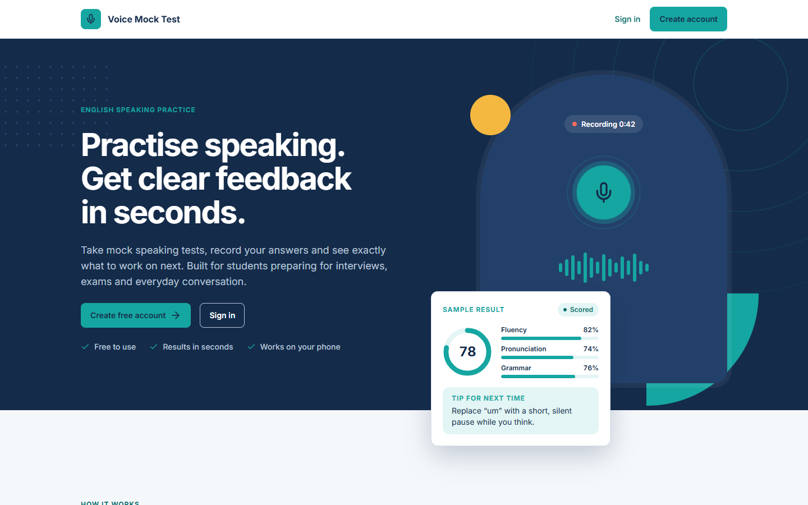

## Features

| Students | Teachers (admins) |
|---|---|
| Timed speaking tests with thinking time and re-record | Test builder with levels, timings and publishing |
| Scores and feedback per answer and per test | AI generator that writes whole tests from a topic |
| Quick practice on any topic | Review queue for low-score, short or off-topic answers |
| Progress charts and a mistakes notebook | Dashboard, reports and CSV export |
| Email or Google sign-in | Invite, manage and suspend accounts |
| Profile with photo, goals, achievements and data download | Profile with photo, own numbers and sign-in security |

## How scoring works

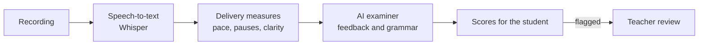

Overall score = 40% fluency + 30% pronunciation + 30% grammar (adjustable). Scoring is free with a Groq key, with Gemini as an optional backup. OpenAI + Claude are also supported. **Demo mode** runs everything with sample scores and no keys.

## Tech stack

**Backend:** Django 5.2, Django REST Framework, JWT auth, PostgreSQL (SQLite for local runs)
**Frontend:** React 19, Vite, React Router
**AI:** Whisper speech-to-text, gpt-oss on Groq, Gemini or Claude for feedback
**Hosting:** Vercel (web), Render (API), Supabase (database and recordings)

## Quick start

Needs **Python 3.11+** and **Node.js 20.19+**.

```bash
# Backend
cd backend
python -m venv .venv
.venv\Scripts\activate             # macOS/Linux: source .venv/bin/activate
pip install -r requirements.txt
copy .env.example .env             # macOS/Linux: cp .env.example .env
python manage.py migrate
python manage.py seed_demo
python manage.py runserver
```

```bash
# Frontend (second terminal)
cd frontend
npm install
npm run dev
```

Open http://localhost:5173. Local sign-in: `admin@example.com` / `admin123` (admin) or `student@example.com` / `student123` (student). On a live server the admin password must be set in `backend/.env`.

Run the tests with `python manage.py test` in `backend/`.

## Documentation

- [Backend guide](backend/README.md): PostgreSQL or Supabase, Google sign-in, real AI scoring, email
- [Frontend guide](frontend/README.md): building and hosting the website
- [`backend/.env.example`](backend/.env.example): every setting, explained

## Screenshots

> Sample students and demo-mode scores.

### Students

| Dashboard | Before the test | Results |
|---|---|---|
| 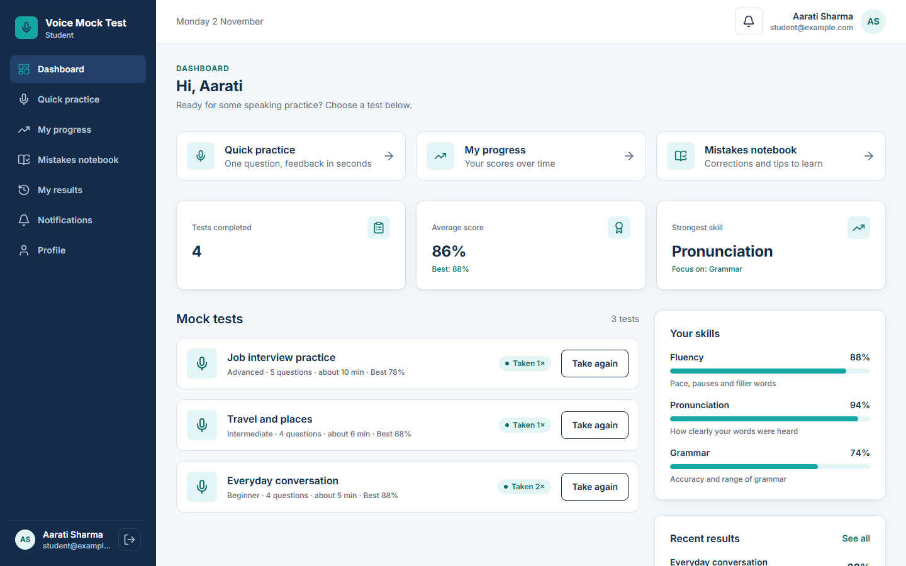 | 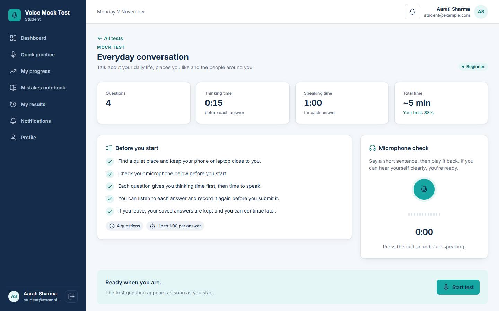 | 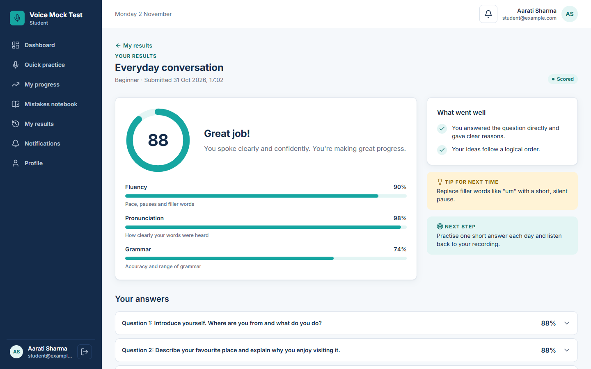 |
| **My progress** | **Quick practice** | **Mistakes notebook** |
| 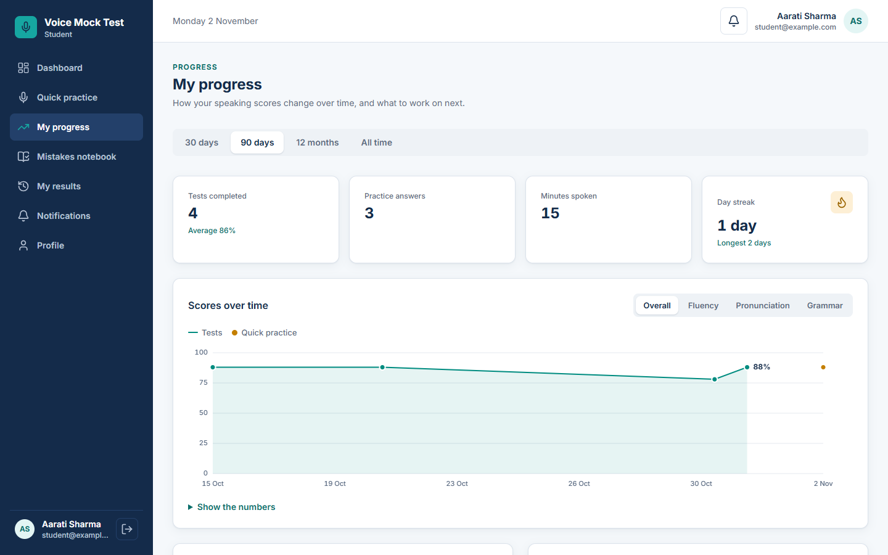 | 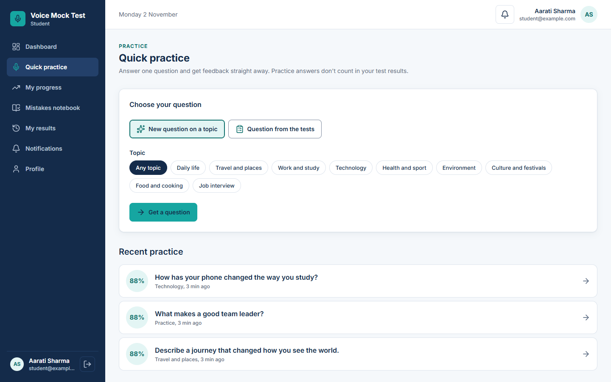 | 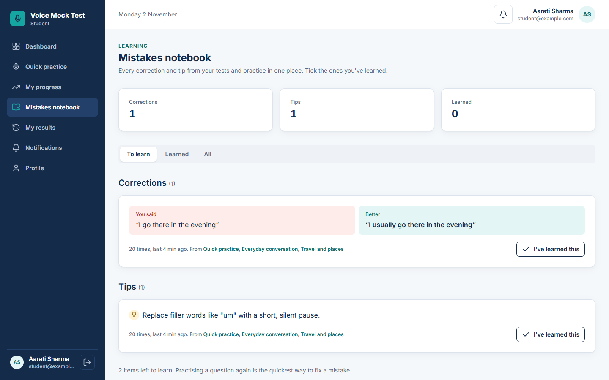 |
| **Profile** | **Profile: goals and achievements** | |
| 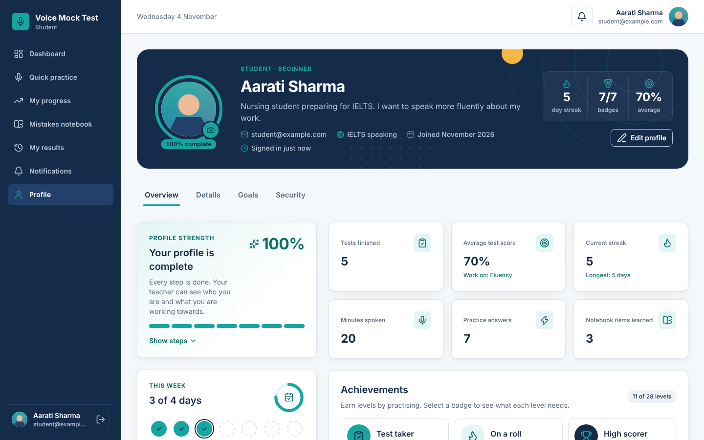 | 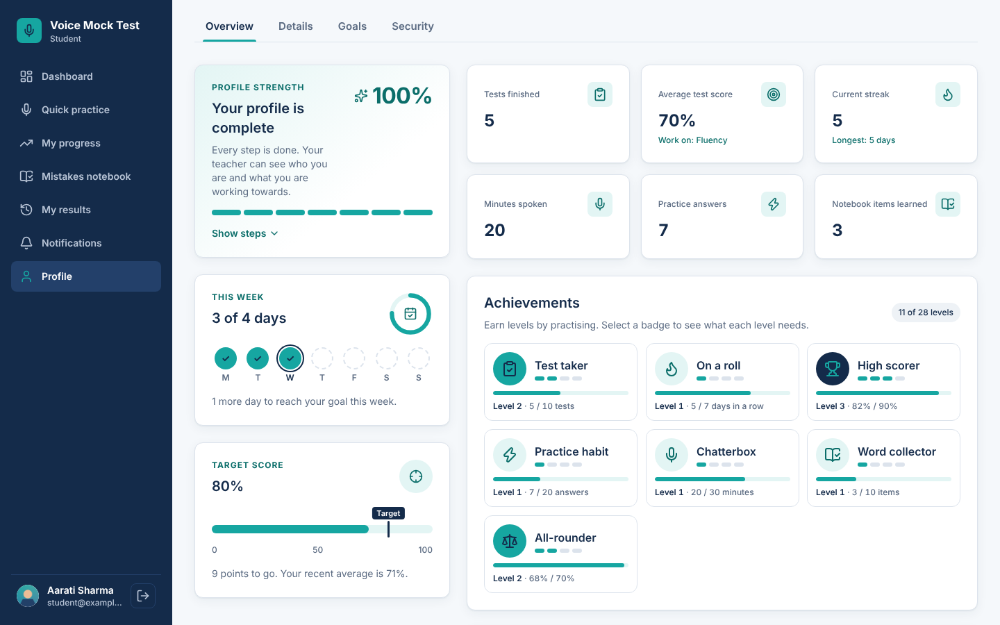 | |

### Teachers

| Dashboard | Answer review | Reports |
|---|---|---|
| 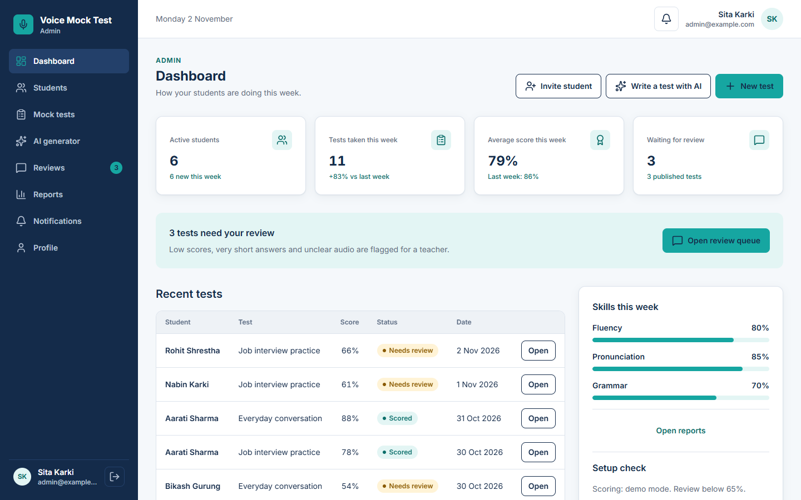 | 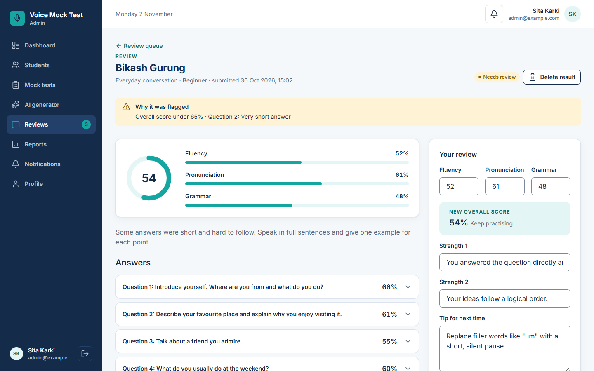 | 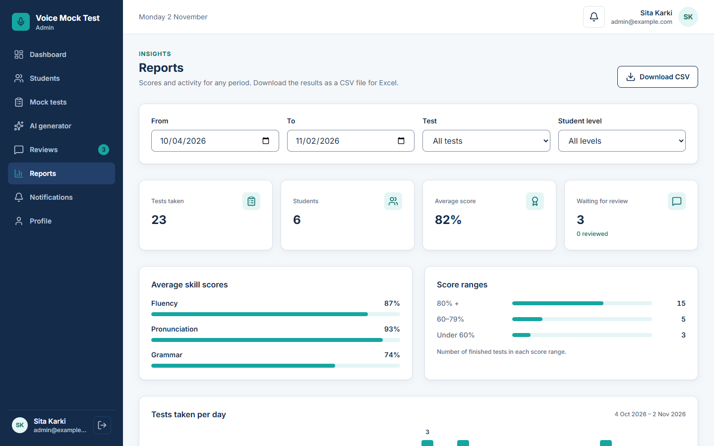 |
| **AI generator** | **Questions** | **Students** |
| 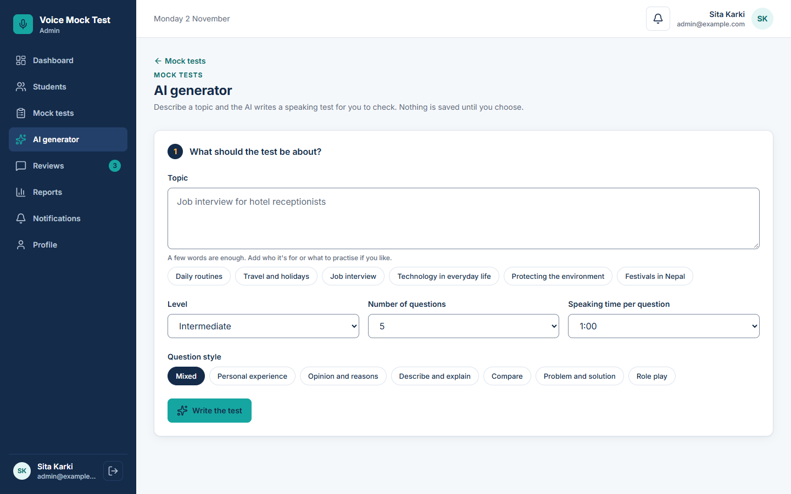 | 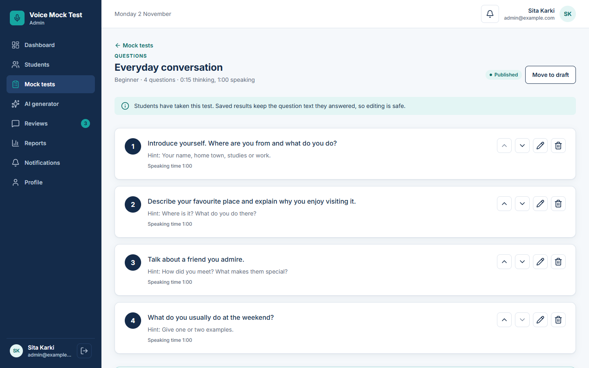 | 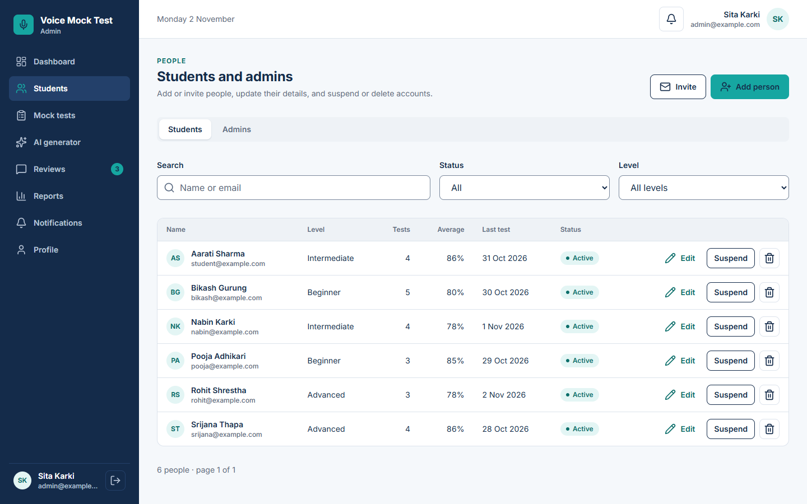 |

### Phone

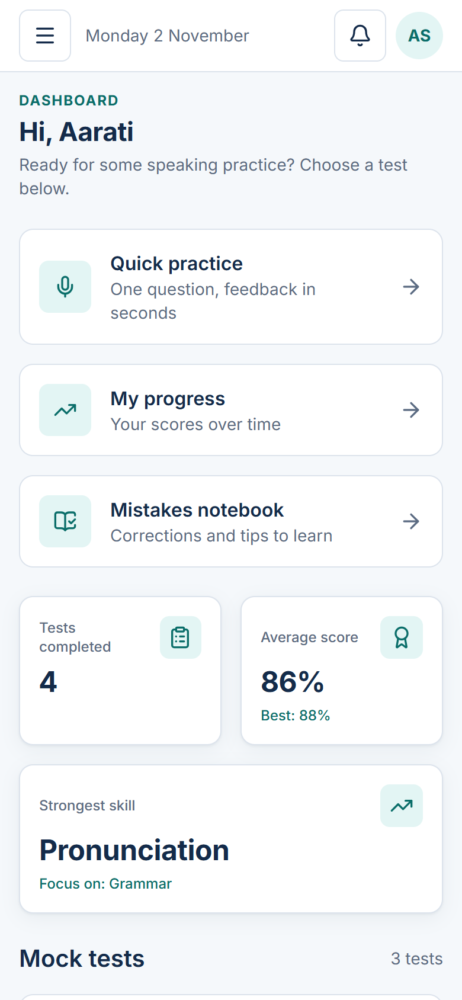

---

Built by **Roshan Rawal**.
