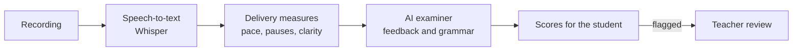

# Voice Mock Test System

Exam-style speaking tests for learners of English. Students record answers in the browser and get scored on **fluency, pronunciation and grammar** with written feedback. Teachers build tests, review flagged answers and track progress.

**Live demo:** https://voice-mock-test-system.vercel.app


## Features

<<<<<<< HEAD
### For students
- **Speaking tests that feel like the real exam.** Each question has thinking time, then a timed recording. Students can listen back and re-record before submitting.
- **Microphone check** before every test, so a broken mic is caught before the first question.
- **Scores and feedback** for each answer and the whole test: fluency, pronunciation and grammar, what went well, one tip for next time and a next step.
- **Progress over time:** history of every test, average and best scores, strongest skill and the skill to focus on.
- **Pick up where you left off:** leaving a test keeps the saved answers, and the student continues at the next question.
- **Sign in with email or Google**, and reset a forgotten password by email.
- **Interactive profile:** a profile photo (drag and drop, then move and zoom to crop), a profile-strength meter with one-click next steps, achievements with four levels each, a weekly practice goal and a target score, personal bests, a password strength guide, "sign out of other devices", "Download my data" and "Delete my account".

### For teachers (admins)
- **Test builder:** create tests per level (beginner, intermediate, advanced), add and reorder questions with hints, set thinking and speaking time, allow or block retakes, and publish, unpublish or archive tests.
- **Review queue:** answers with low scores, very short answers, unclear audio or off-topic content are flagged automatically. The teacher can listen to the recording, read the transcript, adjust scores and feedback, re-score an answer and publish the review, with an optional email to the student.
- **Dashboard:** active students, tests taken this week compared with last week, average score and skills this week.
- **Reports:** filter by date, test and level; see skill averages, score ranges, tests per day and results by test, and download everything as a CSV file for Excel.
- **People management:** invite students or admins by email link, change levels, suspend accounts and search or sort by score.

### Under the hood
- JWT authentication with refresh-token rotation and sign-out (token blacklist).
- Role-based access: students only ever see their own data.
- Request limits on sign-in, sign-up and password reset.
- One-time links for invitations and password resets, stored only as SHA-256 hashes.
- **Demo mode:** the whole app works without any API keys by using sample scores.
- Recordings stored locally or in S3-compatible storage (for example Supabase Storage).
- Optional API endpoints for n8n automations (pending-review alerts, weekly summary email).
- 92 automated backend tests, run on SQLite and PostgreSQL.

---
=======
| Students | Teachers (admins) |
|---|---|
| Timed speaking tests with thinking time and re-record | Test builder with levels, timings and publishing |
| Scores and feedback per answer and per test | AI generator that writes whole tests from a topic |
| Quick practice on any topic | Review queue for low-score, short or off-topic answers |
| Progress charts and a mistakes notebook | Dashboard, reports and CSV export |
| Email or Google sign-in | Invite, manage and suspend accounts |
>>>>>>> 776593a9bbe0e6c60ed51664fd6e6f19578a673d

## How scoring works



<<<<<<< HEAD
- **Overall score** = 40% fluency + 30% pronunciation + 30% grammar. The weights can be changed in `backend/.env`.
- **Flagged for review:** an answer is sent to the review queue when its score is under 65%, it's very short, the audio is hard to hear, or it may be off topic.
- **Free scoring:** with `AI_PROVIDER=groq`, one free Groq key runs both steps (Whisper speech-to-text and the open gpt-oss model for feedback).
- **Free backup:** with `GEMINI_API_KEY` set, Google Gemini writes the feedback whenever Groq is busy or over its free limit.
- **Test AI connection:** a button on the admin dashboard sends one small request to each service and shows ✓ or ✗.
- **Paid scoring:** with `AI_PROVIDER=openai`, OpenAI speech-to-text and Anthropic Claude feedback.
- **Demo mode** (`EVALUATION_DEMO_MODE=True`) skips the AI calls and returns sample scores, so the app can be run and shown without any keys.

---

## Screenshots

> Screenshots use sample students and demo-mode scores.

### Student

| Dashboard | Speaking test |
|---|---|
|  |  |
| **Results** | **History** |
|  |  |
| **Profile** | **Profile: goals and achievements** |
|  |  |

### Admin

| Dashboard | Review an answer |
|---|---|
|  |  |
| **Reports** | **Students** |
|  |  |
| **Mock tests** | **Question editor** |
|  |  |

### Phone

Every page works on phones, with a slide-out menu.


---
=======
Overall score = 40% fluency + 30% pronunciation + 30% grammar (adjustable). Scoring is free with a Groq key, with Gemini as an optional backup. OpenAI + Claude are also supported. **Demo mode** runs everything with sample scores and no keys.
>>>>>>> 776593a9bbe0e6c60ed51664fd6e6f19578a673d

## Tech stack

**Backend:** Django 5.2, Django REST Framework, JWT auth, PostgreSQL (SQLite for local runs)
**Frontend:** React 19, Vite, React Router
**AI:** Whisper speech-to-text, gpt-oss on Groq, Gemini or Claude for feedback
**Hosting:** Vercel (web), Render (API), Supabase (database and recordings)

## Quick start

Needs **Python 3.11+** and **Node.js 20.19+**.

```bash
# Backend
cd backend
python -m venv .venv
.venv\Scripts\activate             # macOS/Linux: source .venv/bin/activate
pip install -r requirements.txt
copy .env.example .env             # macOS/Linux: cp .env.example .env
python manage.py migrate
python manage.py seed_demo
python manage.py runserver
```

```bash
# Frontend (second terminal)
cd frontend
npm install
npm run dev
```

Open http://localhost:5173. Local sign-in: `admin@example.com` / `admin123` (admin) or `student@example.com` / `student123` (student). On a live server the admin password must be set in `backend/.env`.

Run the tests with `python manage.py test` in `backend/`.

## Documentation

- [Backend guide](backend/README.md): PostgreSQL or Supabase, Google sign-in, real AI scoring, email
- [Frontend guide](frontend/README.md): building and hosting the website
- [`backend/.env.example`](backend/.env.example): every setting, explained

## Screenshots

> Sample students and demo-mode scores.

### Students

| Dashboard | Before the test | Results |
|---|---|---|
|  |  |  |
| **My progress** | **Quick practice** | **Mistakes notebook** |
|  |  |  |

### Teachers

| Dashboard | Answer review | Reports |
|---|---|---|
|  |  |  |
| **AI generator** | **Questions** | **Students** |
|  |  |  |

### Phone

<<<<<<< HEAD
### Tests

```bash
cd backend
python manage.py test
```

---

## Project structure

```
voice-mock-test-system/
├── backend/                 Django REST API
│   ├── config/              settings and URLs
│   └── apps/
│       ├── accounts/        users, roles, sign-in, Google sign-in, invitations, password reset
│       ├── tests_manager/   mock tests and questions
│       ├── attempts/        taking tests, answers, results, reviews, dashboard, reports
│       ├── evaluation/      speech-to-text, scoring rules, written feedback (Groq or OpenAI + Claude)
│       ├── notifications/   emails and n8n endpoints
│       └── common/          shared helpers and permissions
└── frontend/                React website
    └── src/
        ├── pages/           student, admin and public pages
        ├── components/      buttons, fields, recorder, dialogs, score ring…
        ├── layouts/         page frames (sidebar + top bar)
        ├── services/        API calls with automatic token refresh
        ├── hooks/           microphone recording
        └── styles/          design tokens and styles
```

## API overview

All endpoints are under `/api/`.

| Area | Endpoints |
|---|---|
| Auth | `auth/register/`, `auth/login/`, `auth/google/`, `auth/refresh/`, `auth/logout/`, `auth/me/`, `auth/password-reset/` |
| Profile | `auth/me/` (GET, PATCH), `auth/me/password/`, `auth/me/summary/`, `auth/me/avatar/` (POST, DELETE), `auth/me/sign-out-others/`, `auth/me/export/`, `auth/me/delete/` |
| Student | `tests/`, `attempts/`, `attempts/{id}/answers/`, `attempts/{id}/submit/`, `me/stats/` |
| Admin | `admin/users/`, `admin/users/invite/`, `admin/tests/`, `admin/questions/`, `admin/attempts/`, `admin/attempts/{id}/review/`, `admin/dashboard/`, `admin/reports/`, `admin/reports/export/` |
| Scoring | `evaluation/config/`, `evaluation/answers/{id}/rescore/` |
=======

>>>>>>> 776593a9bbe0e6c60ed51664fd6e6f19578a673d

---

Built by **Roshan Rawal**.
